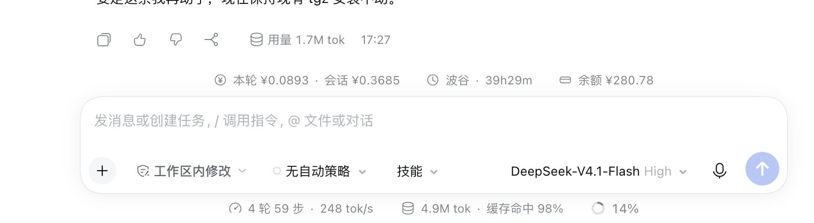
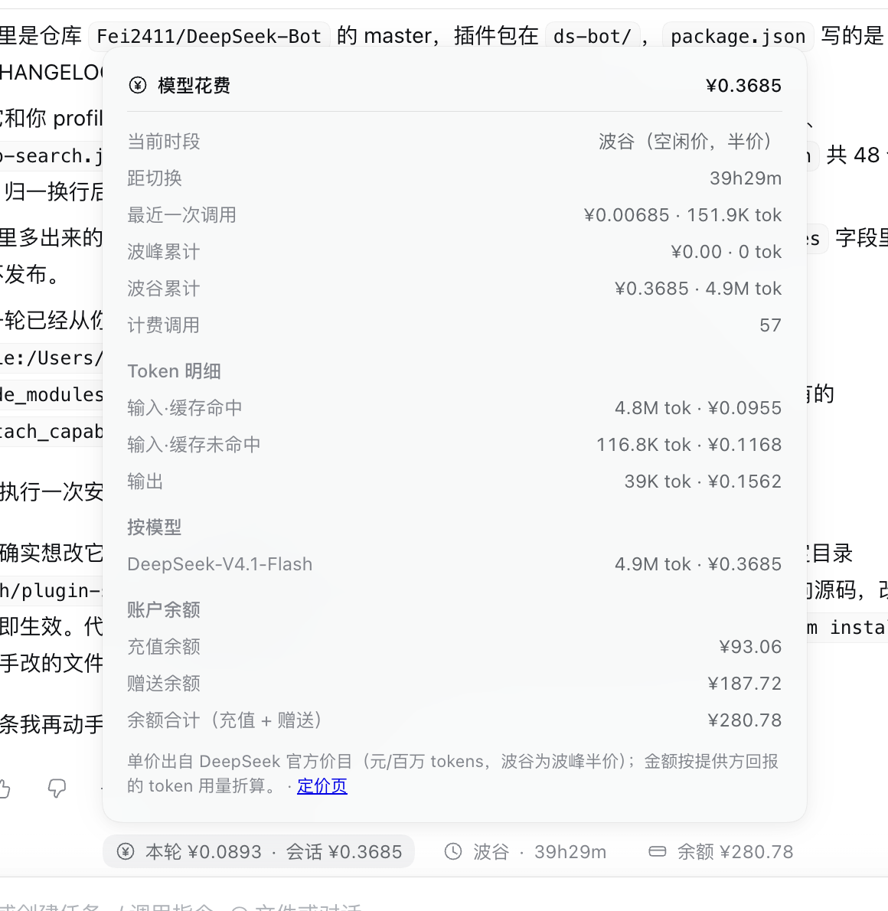

# dsh-cost-meter

DSH 状态栏上的花费计量：**本轮/会话花了多少钱、现在是波峰还是波谷、账户还剩多少余额**。

## 它长什么样

**任务执行中** —— 独占输入卡上方那一行，完整显示四项（执行行的步骤文字是动态的，不与它抢宽度，任何窗口宽度都不重叠）：



**任务结束后** —— 落到最后一轮「用量 / 时间」那一行的右端，按剩余宽度自适应缩略：


**点金额那一颗** —— 展开明细：当前时段与距切换、最近一次调用、波峰/波谷累计、四个 token 桶的
数量与金额、按模型拆分、未计价提示、账户余额构成与单价出处：



三颗 pill 分别是：

| pill | 内容 | 来源 |
|---|---|---|
| ¥ 本轮 / 会话 | 本轮实时金额（在飞调用按已吐字符折算，带 `≈`；落地即精确值）+ 会话累计 | 宿主会话投影，逐调用按发生时刻的峰谷价计价 |
| 🕐 波峰/波谷 · 倒计时 | 当前时段 + 距下次切换的倒计时 | 北京时间工作日高峰窗口，不含法定节假日 |
| 👛 余额 | 充值 + 赠送合计（平台口径） | 官方账号通道实时读取 |

只挂**一处**（输入卡上方那一条 `conversation.input.dock`，`order: 30`），再由组件把内容
portal 到当前该在的那一行。于是任何状态下都看得见，也不会重复出现：

| 状态 | 落点 | 位置 |
|---|---|---|
| 执行中 | 留在自己的槽位（`conversation.input.dock`） | 输入卡上方那一条，居中，**完整形态**。执行行的核心内容是动态的（步骤文字逐字生长、流光动画的矩形随动画脉动），采样式测宽永远追不上它，绝对定位摆进去迟早压字——不与它竞争 |
| 已停止 / 已结束 | 聊天里**最后一个** `[data-turn-tail]`（轮次尾巴） | 排在「用量 3.8M tok / 16:04」同一行的右端 |
| 两处都没有 | 留在自己的槽位（`conversation.input.dock`） | 输入卡上方那一条，居中 |

```
🐳 深度求索中，用时 1分15秒 ···
                  ¥ 本轮 ≈¥0.20 · 会话 ¥4.27 🕐 波峰 · 1小时57分 余额 ¥93.07
⧉ 👍 👎 ↗   用量 3.8M tok  16:04                            ¥ 本轮 ¥0.99 · 会话 ¥6.10 🕐 波峰 · 1小时57分 余额 ¥93.07
```

**两个落点容器只被加了 `position:relative`，它们自己的布局一个字都没改**——不动
`flex-direction`、不动 `order`、不动 `flex`、不动 `margin`，本包条目用绝对定位摆到右侧。
这一条是踩出来的：早先的版本改了容器的 flex 布局（`flex-direction:row` + `margin-left:auto`），
在真实页面里把核心内容（图标、流光文字、动作行）推偏甚至顶出边界；改成绝对定位后，
核心那几行怎么排完全不受本包影响。位置不够时是本包自己缩（余额、时段先让位，标签走省略号，
最窄只剩图标），绝不换行、也不挤别人。

为什么按 DOM 找行、而不按轮次号判断：`turn`（slot owner）/`turnOrder`（聊天快照）这两条线值
在停止任务、分页、重放这些路径上都可能对不齐，而「显示在哪一行」本来就只是个位置问题——
认 DOM 里最后那一个尾巴既简单又不会错。`[data-chat-running]` / `[data-turn-tail]` 都是稳定的
`data-*` 属性（类名是构建期哈希，不能写死）。找不到时退回自己的槽位，不存在「什么都不显示」的状态。

点第一个 pill 展开明细：当前时段与距切换、最近一次调用、波峰/波谷累计、
四个 token 桶各自的 token 数与金额、按模型拆分、未计价提示、账户余额与单价出处。

### 「本轮」为什么带 `≈`

提供方要到**流结束**才在末尾的 usage 分片里报 token 数，只等事件落地的话，一次长调用
期间这个数会一动不动。所以本轮金额 = 已结算调用（投影里的精确值）+ 在飞那一次：
输出按已流出的字符数 ÷ 4 折算（与 `dsh-token-meter` 的固定启发式同一密度），
提示词用**上一次调用**的桶作为代理——同一个 agent 循环里相邻请求的提示词几乎相同，
这正是缓存命中率能到 99% 的原因。`≈` 表示这是估算；调用一落地，精确值就替换它、标记消失。
会话累计永远是精确值。

只有一轮时「本轮」就等于「会话」，重复显示同一个数没有信息量，界面只显示前者（明细里两者都在）。

## 数从哪来

| 显示 | 来源 | 为什么这么取 |
|---|---|---|
| 金额（已结算） | 宿主侧会话投影 `costMeter`（本包 `index.js` 注册） | 日志每个事件都带 `time`，`request/context` 记路由，`assistant/message` 带 `usage`；按**调用发生时刻**的时段逐笔计价，跨时段切换也不会算错 |
| 本轮的在飞部分 | 客户端读聊天目标的 `legacy.partial`（`src/client/estimate.js`） | 流式字符数是提供方报 usage 之前唯一的实时信号；提示词用上一次调用的桶代理 |
| 当前时段与倒计时 | 客户端按同一份时段表实时算（`src/shared/schedule.js`） | 投影只在事件落库时推一次，空闲时不会为了走时钟推帧；时段判定两边共用一份规则 |
| 余额 | 账号 Remote `ctx.remote.account.getBalance` | 官方通道，不自己开 HTTP 路由；**合计 = 充值余额 + 赠送余额**（平台口径），按币种分别求和 |

金额累加用**整数纳元**（1 元 = 1e9 纳元）：单价写成最多 3 位小数时整个乘法是精确的，
几万次调用累加也不掉精度——用浮点累加会把「对得上账单」变成「大概对得上」。

余额同理用**整数分**：`93.06 + 196.60` 在 double 里是 `289.65999999999997`，平台按截断显示，
直接相加会少一分钱（这条有单测钉着）。显示规则也照平台：一律两位小数、不足一分显示 `<¥0.01`。

## 单价与时段

单价、时段窗口、法定节假日全在 `cordis.patch.yml` 的 `config` 里，改它不需要重新构建客户端。

- 价目出处：<https://api-docs.deepseek.com/zh-cn/quick_start/pricing>
  （`deepseek-flash`、`deepseek-v4-pro` 的高峰/空闲两档价，单位「元 / 百万 tokens」）
- 高峰时段：北京时间周一至周五 9:00–12:00、14:00–18:00，**不含中国法定节假日**；
  其余时段（含周末与节假日全天）为空闲时段，单价为高峰的一半。
- 节假日表：国办发明电〔2025〕7号（2026 年）。**每年国务院发新通知后要更新那一段**——
  价格不会变，节假日会。
- 货币：`pricing.currency` 要与账户钱包的货币一致（价目表本身有人民币与美元两版）。

查价顺序是 `provider/model` → `model` → `pricing.defaultModel`，所以裸 model 名做键时
`deepseek-official`（API Key 路由）与 `deepseek-account`（账号路由）共用同一份官方价。

第三方路由（qwen / moonshot / sensenova …）**故意不配单价**：没有权威价目来源，
未配单价的调用会单独显示成「未计价」并列出 token 数，而不是被当成 0 元混进总额。

## 安装（给别人用的话看这一段）

前提：装好并至少跑过一次 DSH（桌面端或 `dsh web` 都行），profile 目录在
`$DSH_HOME/profiles/<profile>`（默认 `~/.dsh/profiles/desktop`；`dsh web` 用的是 `web`）。
**不需要构建**：仓根的 `client.js` 是构建产物、随包提交，装的人只要链接 + 重载。

1. 把本仓放到一个**不会被清理**的目录（别放 `/tmp`），记下绝对路径，下面用 `<本仓>` 代替。
2. 编辑 `<profile>/package.json` 两处：

```jsonc
{
  "dependencies": {
    "dsh-cost-meter": "link:<本仓>"          // ← 加这一行（绝对路径）
  },
  "dsh": { "profile": { "bundles": [
    "...",
    "dsh-cost-meter"                          // ← 列表里加这一项
  ] } }
}
```

3. 链接进 profile（按系统选一条）：

```bash
# macOS / Linux
cd "$DSH_HOME/profiles/desktop" && pnpm install
```

```powershell
# Windows PowerShell（路径用正斜杠，JSON 里就不用转义反斜杠）
cd "$env:USERPROFILE\.dsh\profiles\desktop"; pnpm install
```

Windows 上 profile 的 package.json 里写成 `"dsh-cost-meter": "link:C:/Users/<你>/dsh-cost-meter"`
（正斜杠；写成 `C:\...` 时 JSON 里要双反斜杠）。

4. 重载 profile：桌面端刷新窗口（⌘R / Ctrl+R），或重启应用；CLI 端重启进程。
5. 看效果：输入框上方或轮次尾部会出现 `¥ 本轮 … · 会话 … 波峰 … 余额 …`；
   点它展开明细。看不到就先翻到对话最底部（它跟着最新一轮走）。

**卸载**：把上面加的两行删掉，`pnpm install`，重载。

### 出问题时

- 界面显示 `花费 —`：宿主投影没注册成功（配置写错会在**宿主日志**里留一条
  `dsh-cost-meter: 配置有误…`，不会让整个 profile 加载失败）。
- 完全看不到那条：客户端模块没加载（profile 的 bundles 少了名字，或没重载）。
- 位置/宽度不对：那一行找不到时它会退回输入框上方自己那一条，**不会消失**。

### 兼容性

- 目标 DSH：`0.2.0-rc.2` 实测可用。它依赖三个稳定的 `data-*` 属性
  （`data-chat-running` / `data-turn-tail` / `data-chat-flow`）来定位行；这些属性在核心产物里是
  稳定契约（类名才是构建期哈希）。属性若在未来版本改名，插件会**降级**到输入框上方那一条，
  不会报错、不会影响核心界面。
- 余额那一项依赖桌面端账号插件的 Remote（`remote.account`）；没有它的组合里自动不显示，
  花费与时段照常。
- 金额按 DeepSeek 官方价目与提供方回报的 token 折算，权威账单以开放平台为准。

## 开发

## 开发

```bash
pnpm install          # 只装构建期依赖（esbuild / js-yaml / react / react-dom）
pnpm run build        # src/client/** → client.js（__ModuleLoader__ 信封）
pnpm test             # 64 项：时段判定、计价算术、折叠语义、schema、词典、估算、余额/金额、
                      #        缩略与落点（含稳定性：数字长大、窗口抖动都不许来回跳）、构建约束
                      #        + jsdom 里真渲染一遍组件（落点、缩略、空会话、投影缺席）
pnpm run check <session.v4.jsonl[.zstd]>   # 拿真实会话日志折一遍账
python3 scripts/check-real-log.py <log>    # 独立第二通道，两边的纳元必须完全相等
node scripts/layout-check.mjs              # 用无头浏览器把三种落点各渲染一遍并截图
node scripts/layout-probe.mjs <in.html> <out.html>   # 注入探针，--dump-dom 读真实几何量
```

### 余额刷新节奏

- 有调用落地就刷一次，节流 5 秒；
- 执行中每 10 秒兜底轮询一次；
- 空闲时交给 store 自己的 60 秒轮询——那时候余额本来也不会变。

平台自己的用量页写着「数据可能有 5 分钟延迟」，余额是账户侧的实时数，但没必要更密地打。

### 放不下就缩略

宽度不够时按固定顺序丢信息，绝不重叠、绝不换行、绝不裁一半。丢的顺序是
**切换倒计时 → 会话总额 →「余额」这个词 → 整个时段 pill**：

- 余额的**数字**任何宽度下都留着（旁边就是银行卡图标，去掉「余额」两字不会认错）；
- 花费那一颗是主角，永远留到最后；
- 会话总额在明细面板里一直有，所以它可以先走。

判据是组件量出来的**容器剩余宽度**（聊天列有 `--dsh-chat-content-width` 上限，本机实测那一行只有
680px，而核心的「图标 + 用量 + 时间」自己就占掉三百多——所以按行宽设绝对阈值是错的，
只能按剩余宽度算），逻辑在 `src/client/compact.js`（纯函数、有单测），样式按 `data-compact` 上的标记生效。
级别推进带迟滞（变紧立刻、放宽要留 40px 余量），否则金额每长大一点就会来回跳。

### 布局自检

这个插件把内容摆进核心 DOM（那几个容器没有槽），所以布局必须在真实 DOM 上量，不能靠读源码推断：

- `scripts/layout-check.mjs`：用从核心产物里抄出来的 CSS 片段 + 本包真实的 `styles.js`，
  在无头 Edge 里把三种落点渲染成 `layout-check/*.png`，DOM 顺序两种都测。
- 插件内置一条诊断通道：客户端把「落点容器 / 本包条目"的真实矩形与计算样式 POST 给宿主，
  宿主写到 `$DSH_HOME/cost-meter-diag.json`（`src/client/diagnose.js` + `index.js` 的路由）。

运行时的 `require` 只能出现 DSH 客户端 seed 表里的 9 个模块，构建脚本会逐条核对产物，
越界即构建失败。改完 `src/client/**` 一定要 `pnpm run build`——`pnpm test` 里有一项会
比对仓根 `client.js` 与源码，忘了重新构建会直接失败。

## 已知边界

- 金额按**提供方回报的 token 用量**折算，权威账单以开放平台为准；`cacheWrite` 官方价目
  没有单列（DeepSeek 不上报 cache write），缺省按缓存未命中价计，也就是不少算的那一侧。
- 投影状态里逐轮明细只留最近 50 轮，会话总额不受影响。
- 分叉（fork）会话继承的日志会被一并计价：投影口径是「这份日志的用量」，
  与 `tokenUsage` 投影一致。
